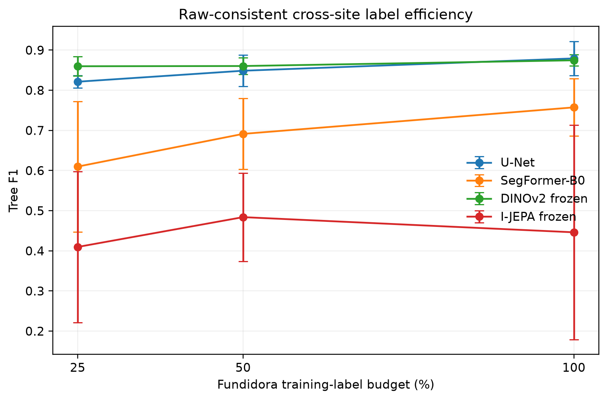
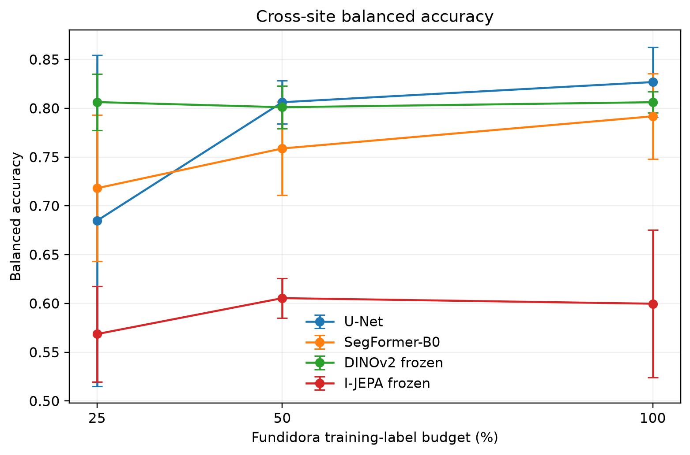
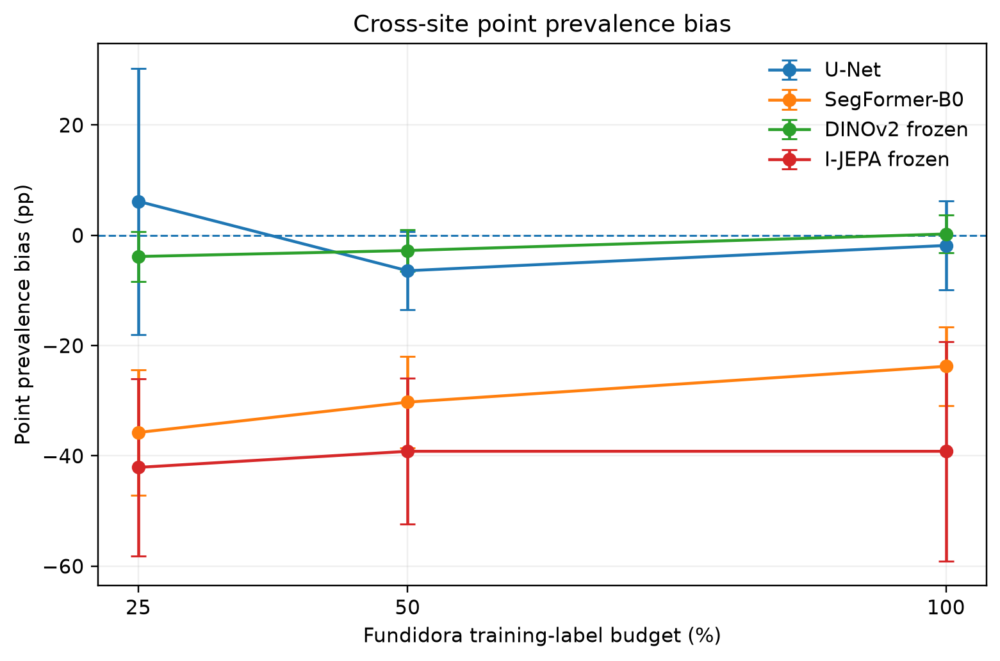
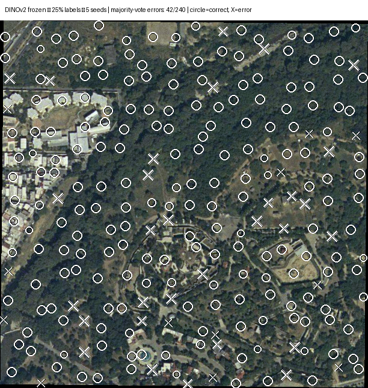
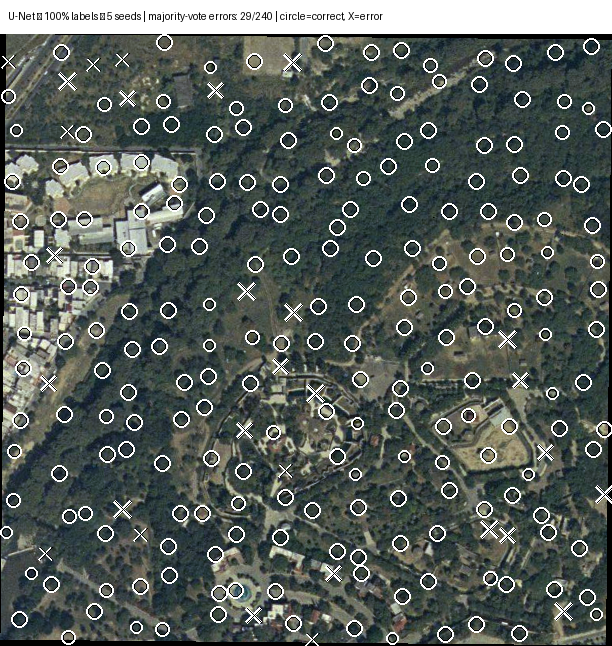

# M3c — Raw-consistent v2 UTC benchmark results

## Why v2 was necessary

The legacy Fundidora v1 segmentation inputs used a per-patch 2–98% percentile stretch. That made the first Fundidora → La Pastora transfer study useful as a controlled legacy-model evaluation, but it left a preprocessing mismatch as an important methodological caveat.

M3c removes that caveat by rebuilding Fundidora model inputs from the original 2007 uint8 orthophoto using the exact existing patch coordinates, masks, and spatial splits, with **no per-patch percentile stretch**. La Pastora is then evaluated with the same raw-RGB policy.

## Experimental design

- Source/training site: Fundidora, 2007, 1 m RGB
- Target/validation site: La Pastora, 2007, 1 m RGB
- Fundidora masks and spatial split assignments: unchanged from v1
- Target reference: 240 independent model-blind human points
- Target class counts: 162 tree / 78 non-tree
- Seeds: 42–46
- Label budgets: 25%, 50%, 100%
- Models: U-Net, SegFormer-B0, frozen DINOv2 + decoder, frozen I-JEPA ViT-H/14 + decoder
- Threshold selection: Fundidora validation only
- Target calibration/fitting: none
- Target preprocessing: raw RGB
- Reported IoU: point-classification Jaccard, not dense-mask IoU
- Reported prevalence bias: sampled-point prevalence bias, not UTC area bias

## Raw-consistent cross-site results

| Model | Fundidora labels | Balanced accuracy | Tree F1 | Point IoU | Point prevalence bias |
|---|---:|---:|---:|---:|---:|
| U-Net | 25% | 0.685 ± 0.170 | 0.821 ± 0.016 | 0.697 ± 0.023 | +6.17 ± 24.14 pp |
| U-Net | 50% | 0.806 ± 0.022 | 0.849 ± 0.039 | 0.739 ± 0.058 | -6.42 ± 7.12 pp |
| U-Net | 100% | 0.827 ± 0.036 | 0.879 ± 0.043 | 0.787 ± 0.067 | -1.83 ± 8.09 pp |
| SegFormer-B0 | 25% | 0.718 ± 0.075 | 0.610 ± 0.163 | 0.453 ± 0.158 | -35.75 ± 11.35 pp |
| SegFormer-B0 | 50% | 0.759 ± 0.048 | 0.691 ± 0.088 | 0.534 ± 0.107 | -30.25 ± 8.34 pp |
| SegFormer-B0 | 100% | 0.792 ± 0.044 | 0.757 ± 0.071 | 0.614 ± 0.094 | -23.75 ± 7.14 pp |
| **DINOv2 frozen + decoder** | **25%** | **0.806 ± 0.029** | **0.860 ± 0.024** | **0.755 ± 0.036** | **-3.83 ± 4.50 pp** |
| **DINOv2 frozen + decoder** | **50%** | **0.801 ± 0.022** | **0.860 ± 0.021** | **0.755 ± 0.033** | **-2.75 ± 3.73 pp** |
| **DINOv2 frozen + decoder** | **100%** | **0.806 ± 0.011** | **0.875 ± 0.014** | **0.777 ± 0.022** | **+0.25 ± 3.39 pp** |
| I-JEPA frozen + decoder | 25% | 0.569 ± 0.049 | 0.410 ± 0.188 | 0.271 ± 0.141 | -42.08 ± 16.05 pp |
| I-JEPA frozen + decoder | 50% | 0.605 ± 0.020 | 0.484 ± 0.110 | 0.325 ± 0.098 | -39.17 ± 13.24 pp |
| I-JEPA frozen + decoder | 100% | 0.600 ± 0.075 | 0.446 ± 0.267 | 0.317 ± 0.218 | -39.17 ± 19.93 pp |

## Publication figures

*Figure 1. Mean Tree F1 ± sample standard deviation across seeds 42–46. DINOv2 is strongest and most stable at reduced label budgets; U-Net becomes competitive with full supervision.*

*Figure 2. Mean balanced accuracy ± sample standard deviation. The large U-Net variance at 25% reflects unstable low-label behavior across seeds.*

*Figure 3. Mean sampled-point prevalence bias ± sample standard deviation. DINOv2 remains close to zero across label budgets. This metric is not UTC area bias.*

### Cross-site point-error examples

*Figure 4. DINOv2 at 25% Fundidora labels. Circles indicate points correctly classified by majority vote across seeds; X marks majority-vote errors.*

*Figure 5. U-Net at 100% Fundidora labels, showing the fully supervised baseline after raw-consistent preprocessing.*

The machine-readable publication table is available at `docs/assets/m3c/publication_results_table.csv`.

## What changed relative to v1

The raw-consistent correction materially changes the supervised baselines:

| Model / budget | v1 F1 | v2 F1 | Change |
|---|---:|---:|---:|
| U-Net 25% | 0.078 | 0.821 | +0.743 |
| U-Net 50% | 0.087 | 0.849 | +0.762 |
| SegFormer 25% | 0.211 | 0.610 | +0.399 |
| SegFormer 50% | 0.097 | 0.691 | +0.594 |
| DINOv2 25% | 0.847 | 0.860 | +0.013 |
| DINOv2 50% | 0.874 | 0.860 | -0.014 |
| I-JEPA 25% | 0.361 | 0.410 | +0.049 |
| I-JEPA 50% | 0.530 | 0.484 | -0.046 |

This shows that the legacy v1 preprocessing mismatch disproportionately damaged the supervised U-Net and SegFormer branches during cross-site transfer. DINOv2 was comparatively insensitive to that preprocessing change, which itself is evidence of representation robustness.

## Revised interpretation

The v2 benchmark supports a more precise claim than the original v1 result:

> **Frozen DINOv2 provides the strongest and most stable low-label cross-site transfer in the raw-consistent Fundidora → La Pastora benchmark. Its advantage is clearest at 25% labels and remains competitive at 50%. At 100% labels, U-Net is statistically competitive and slightly higher in mean F1/IoU, so DINOv2 should not be described as universally superior at full supervision.**

Important details:

- At **25% labels**, DINOv2 leads on mean F1 (0.860) and point IoU (0.755), while U-Net has comparable mean F1 only because two seeds degenerate to predicting all points as tree, producing very high balanced-accuracy variance and prevalence-bias variance.
- At **50% labels**, DINOv2 and U-Net are close in F1 (0.860 vs 0.849), but DINOv2 has lower variance and substantially smaller mean prevalence bias.
- At **100% labels**, U-Net is slightly higher in mean balanced accuracy, F1, and point IoU, while DINOv2 is more stable across seeds and has near-zero mean point-prevalence bias.
- SegFormer improves dramatically after preprocessing correction but still tends to underpredict canopy on La Pastora.
- I-JEPA remains weaker and considerably less stable than DINOv2 in this transfer setting.

## Supported claim

A publication-safe version is:

> On a raw-consistent 1 m RGB cross-site benchmark, frozen DINOv2 features demonstrated the strongest and most stable label-efficient transfer at reduced source-label budgets. The advantage was largest at 25% labels and persisted at 50%, while a fully supervised U-Net became competitive at 100% labels.

## What v2 invalidates

The v1 conclusion that U-Net and SegFormer inherently collapse under cross-site transfer should **not** be retained as a model-level conclusion. Their collapse was strongly influenced by the legacy preprocessing mismatch.

The v1 experiment remains useful as a preprocessing-sensitivity experiment and should be preserved, not deleted.

## Remaining limitations

1. La Pastora validation is point-based rather than a dense canopy mask.
2. Point IoU is not dense segmentation IoU.
3. Point prevalence bias is not UTC area bias.
4. Only one independent external target site is included.
5. Historical 2007 imagery should not be interpreted as current canopy condition.
6. I-JEPA upstream remains CC BY-NC 4.0 and research/prototype-only unless separately licensed.
7. Additional external sites and dense target masks are still required for broad geographic generalization claims.

## Reproducibility

Fundidora raw dataset:

`outputs/utc/fundidora_2007/segmentation_patches_v2_raw`

Fundidora multi-seed training:

`outputs/utc/fundidora_2007/v2_raw_multiseed`

La Pastora raw cross-site outputs:

`outputs/utc/la_pastora_2007/cross_site/v2_raw_multimodel_multiseed`

Aggregate target result:

`outputs/utc/la_pastora_2007/cross_site/v2_raw_multimodel_multiseed/multimodel_multiseed_zero_shot_summary.json`

Protocol:

`research/UTC_V2_RAW_CONSISTENT_BENCHMARK.md`

## M3c decision

**M3c acceptance criterion: satisfied.**

The preprocessing caveat identified after M3b has been directly tested and removed. The corrected benchmark preserves the central DINOv2 label-efficiency finding, but revises the stronger earlier model-ranking claim by showing that raw-consistent U-Net becomes highly competitive with sufficient labels.
